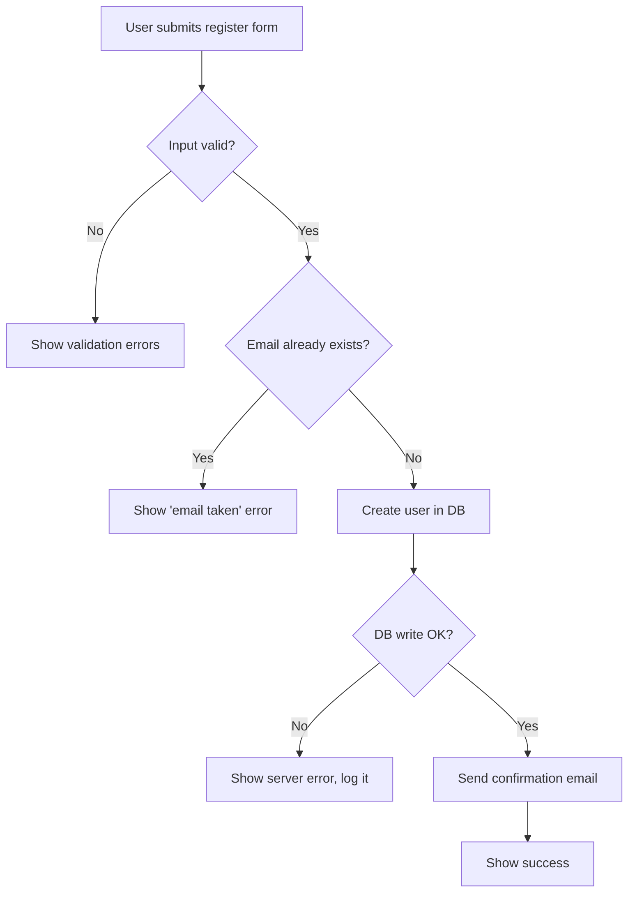

# CLAUDE.md

Guidance for Claude Code when working in the DarkNote project.

## Project setup

- **IDE:** Visual Studio (solution file: `DarkNote.sln`)
- **Development methodology:** Waterfall
- **Backend language:** C# (decided in `PRD.md`, Part 4)
- **Tech stack:** WPF on .NET 10 (LTS), MVVM with CommunityToolkit.Mvvm, JSON storage with `System.Text.Json`. See `PRD.md` Part 4 for details.

## General rules

- Whatever language the input is in, all output must be in English.
- Before the development phase (Stage 3) starts, tell the user which languages, technologies, libraries and tools will be used (including the unit test framework).
- `plan.md` (project root) is the step-by-step checklist of tasks from Stage 2 onward. Mark a task `[x]` as soon as it's done. If `plan.md` is missing, remind the user and help them create it.
- If a significant mistake is found while coding, run `/learn-by-mistake` to record it in `common_errors.md`.
- `project-local-note.md` holds the user's own local notes. It is git-ignored and never committed.

## Waterfall stages

### Stage 1 — PRD (done)
- The PRD is `PRD.md`. It is the source of truth for features, rules and the tech stack.

### Stage 2 — Design
- For each function (feature) in `PRD.md`, create a workflow file: `docs/workflows/<PRD code>-<feature-name>.md` (e.g. `docs/workflows/2.2.1-create-new-note.md`).
- Each workflow file contains a Mermaid flowchart (`flowchart TD`) that covers both the **happy path** and the **edge cases** (invalid input, errors, duplicates, timeouts, damaged files, etc.), plus a short list of the edge cases in text.
- Design the data storage (JSON files) in `docs/data-design.md`.
- Cross-check the workflows against the data design, then get the user's approval before Stage 3.

Example workflow flowchart (happy path + edge cases):

### Stage 3 — Implement
**Setup first:**
- Set up the needed tools and libraries: the WPF project in `DarkNote.sln`, the unit test project, NuGet packages, bundled fonts and icons, and the C# entries in `.gitignore`.

**Then implement functions one by one, in the order in `plan.md`. For each function:**
1. Create a git branch for it from `main` (e.g. `feature/2.2.1-create-new-note`, see `/git-branch`).
2. Read the function's workflow file in `docs/workflows/` before coding, and follow it.
3. Write unit tests for the function, covering the happy path and the edge cases in its workflow.
4. **Stop and show the test cases to the user. Don't run the tests until the user has checked them.**
5. Implement the function. Use the Context7 MCP to check the latest syntax and APIs of the libraries and frameworks used (.NET, WPF, CommunityToolkit.Mvvm, test framework, etc.).
6. Run the tests. If any fail, fix the code (or the test, only if the user agrees the test is wrong) and run again until all tests pass.
7. Stop and wait for the user to check the function (they may use `/explain`).
8. When all tests pass and the user has approved, merge the branch into `main` (see `/merge`) and tick the task in `plan.md`.
9. Don't start the next function until the user gives the go-ahead.

### Stage 4 — Update & new functions
- Starts only when Stage 3 is complete.
- Update existing functions and add new ones (e.g. the future ideas in `PRD.md` Part 5: special notes, PIN lock).
- Each change follows the same flow: add it to `PRD.md` → workflow in `docs/workflows/` → tasks in `plan.md` → branch, tests, user check, implement, all tests pass, user approval, merge.
