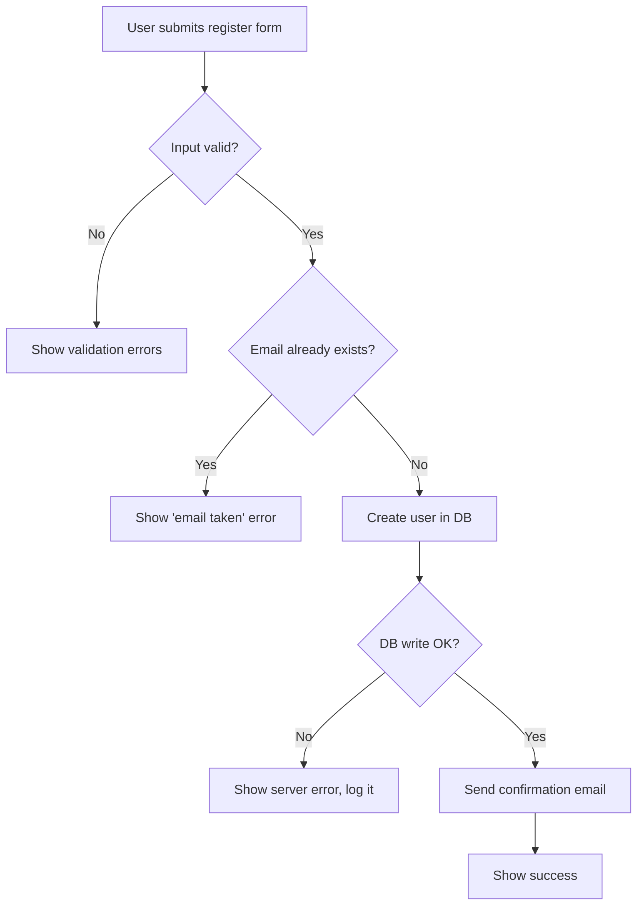

# CLAUDE.md

Guidance for Claude Code when working in the DarkNote project.

## Project setup

- **IDE:** Visual Studio (solution file: `DarkNote.sln`)
- **Development methodology:** Waterfall
- **Backend language:** _Not decided yet. It will be decided in `PRD.md` and recorded here._

## Rules

### Language
- Whatever language the input is in, all output must be in English.

### Technologies
- Before the development phase starts, tell the user which languages and technologies will be used.

### Backend language and IDE setup
- Once the backend language is decided in `PRD.md`, record it in this file (under "Project setup") and finish the IDE setup for it:
  - Add the starter project to `DarkNote.sln` (Visual Studio).
  - Add language-specific entries to `.gitignore` (e.g. `bin/`, `obj/`).
- If `PRD.md` doesn't state the backend language (when the PRD is written, or before Stage 2 starts), remind the user and recommend a few options that fit the project's needs. Give a short reason for each and mark one as recommended (C# by default, unless the PRD suggests a better fit). Record the choice in `PRD.md`.

### Plan (`plan.md`)
- At the start of the project, while designing the stages, if `plan.md` (project root) doesn't exist, remind the user and help them create it.
- `plan.md` is the checklist / to-do list for each Waterfall stage. Mark a task `[x]` as soon as it's done.
- Main stages:
  - **Stage 1: PRD** (sometimes not needed in `plan.md`).
  - **Stage 2: Design**: one task per workflow, plus database tables, then a cross-check of workflows ↔ DB and user approval. Draw each workflow as a Mermaid flowchart (`flowchart TD`). Recommend covering both the happy path and the edge cases (invalid input, errors, duplicates, timeouts, etc.).
  - **Stage 3: Implement**: setup tasks first, then one task per function, each mapped to its Stage 2 workflow.

Example `plan.md`:

```
# Plan & progress

Mark `[x]` as soon as each task is done.

### Stage 2 — Design
- [ ] 2.1 Workflow: Register (Mermaid flowchart: happy path + edge cases)
- [ ] 2.2 Workflow: Log in (Mermaid flowchart: happy path + edge cases)
- [ ] 2.3 Database design `docs/db-design.md` (ERD, tables, constraints)
- [ ] 2.4 Cross-check workflows ↔ DB, user approves design

### Stage 3 — Implement
**Setup**
- [ ] 3.0.1 Initialize backend + unit test framework
- [ ] 3.0.2 Database migration and seed data

**Functions**
- [ ] 3.1 2.1 Register
- [ ] 3.2 2.2 Log in
```

Example workflow flowchart (happy path + edge cases):



### Implement stage
- In Stage 3, implement functions one by one. After each function, stop and wait for the user's go-ahead before starting the next, so they can review it (and possibly use `/explain`).

## Local notes
- `project-local-note.md` holds the user's own local notes. It is git-ignored and never committed.
