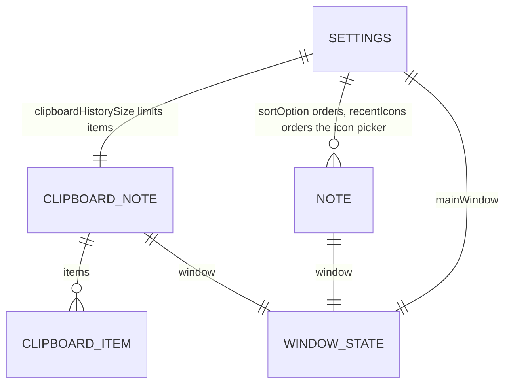

# Data design

**PRD:** 2.4.3 · **Plan:** 2.22

DarkNote has no database. All data is stored as JSON files (`System.Text.Json`) in the app data folder. Property names are camelCase. Enum values are saved as strings, so files stay readable.

## Folder layout

```
%LOCALAPPDATA%\DarkNote\
├─ settings.json          app-wide settings
├─ clipboard.json         the Clipboard Note
├─ notes\
│  ├─ <note-id>.json      one regular note (file name = note id, a GUID)
│  └─ ...
└─ logs\
   ├─ darknote.log        errors and warnings (plain text, not app data)
   └─ darknote.old.log    previous log, kept when darknote.log passes 1 MB
```

- Saving always writes `<file>.tmp` first, then replaces the old file (see [2.4.3](workflows/2.4.3-storage-structure.md)).
- Damaged files are renamed to `<file>.corrupt` and skipped (if that name is taken: `<file>.1.corrupt`, `<file>.2.corrupt`, …, so older copies are never overwritten). Leftover `.tmp` files are deleted at start.
- A file counts as damaged when it is not valid JSON, holds no object, or a field has the wrong JSON type (e.g. text where a number belongs). Unknown enum names and out-of-range values are fixed field by field instead.
- In code, `WindowState` is the class `WindowBounds` (avoids a clash with WPF's `System.Windows.WindowState`); the JSON is the same.



## Shared types

### `WindowState`

| Field | Type | Default | Rules |
|-------|------|---------|-------|
| `left` | number | set when the window opens (2.2.1) | Device-independent units. If off-screen at start → moved to the primary screen (2.4.2) |
| `top` | number | set when the window opens | Same as `left` |
| `width` | number | Note 300 · Main page 400 | Minimum: note 200, main page 320 |
| `height` | number | Note 300 · Main page 600 | Minimum: note 150, main page 400 |

### Enums

| Enum | Values | Default |
|------|--------|---------|
| `NoteColor` | `Yellow`, `Red`, `Blue`, `White`, `Green`, `Purple`, `Pink`, `Orange`, `Gray` | `Yellow` |
| `NoteFont` | `SegoeUI`, `JetBrainsMono`, `Caveat` | `SegoeUI` |
| `FontSizePreset` | `Small`, `Medium`, `Large` | `Medium` |
| `SortOption` | `LastEdited`, `Color`, `Name`, `Icon` | `LastEdited` |
| `NoteIcon` | the 21 Lucide names from PRD 2.2.5, in that order (`info` … `languages`) | `notebook` |

Dark gray (`#1A1A1A`) and the `copy` icon belong to the Clipboard Note only. They are fixed in code and not part of these enums.

**Color constants** (PRD 2.2.5, draft hex values): Yellow `#FACC15`, Red `#EF4444`, Blue `#3B82F6`, White `#F5F5F5`, Green `#22C55E`, Purple `#A855F7`, Pink `#EC4899`, Orange `#F97316`, Gray `#9CA3AF`. White banner text on Red, Blue, Purple; black on the rest.

**Sort orders:** Color = Red, Orange, Yellow, Green, Blue, Purple, Pink, White, Gray. Icon = the preset order.

## `settings.json`

| Field | Type | Default | Validation on load | Used by |
|-------|------|---------|--------------------|---------|
| `schemaVersion` | int | `1` | — | 2.4.3 |
| `sortOption` | `SortOption` | `LastEdited` | Unknown → `LastEdited` | 2.1.3 |
| `mainWindow` | `WindowState` | centered, 400 × 600 | Off-screen / too small → fixed | 2.4.2, 2.6 |
| `clipboardHistorySize` | int | `10` | Not 5, 10 or 20 → `10` | 2.3.4, 2.3.1 |
| `recentIcons` | `NoteIcon[]` | `[]` | Unknown names and duplicates removed | 2.2.5 |
| `trayHintShown` | bool | `false` | — | 2.6 |

```json
{
  "schemaVersion": 1,
  "sortOption": "LastEdited",
  "mainWindow": { "left": 100, "top": 100, "width": 400, "height": 600 },
  "clipboardHistorySize": 10,
  "recentIcons": ["calendar", "notebook"],
  "trayHintShown": false
}
```

## `notes\<note-id>.json`

| Field | Type | Default | Validation on load | Used by |
|-------|------|---------|--------------------|---------|
| `schemaVersion` | int | `1` | — | 2.4.3 |
| `id` | GUID string | new GUID | The file name wins if different | all |
| `name` | string | `"New"` | Longer than 30 → cut to 27 + "..." | 2.2.2, 2.1.1–2.1.3 |
| `isNameManual` | bool | `false` | — | 2.2.2 |
| `content` | string (FlowDocument XAML) | empty document | Can't be parsed → empty document, damaged file renamed to `.corrupt` and kept | 2.2.2, 2.2.3 |
| `color` | `NoteColor` | `Yellow` | Unknown → `Yellow` | 2.2.5, 2.1.3 |
| `icon` | `NoteIcon` | `notebook` | Unknown → `notebook` | 2.2.5, 2.1.3 |
| `font` | `NoteFont` | `SegoeUI` | Unknown → `SegoeUI` | 2.2.4 |
| `fontSize` | `FontSizePreset` | `Medium` | Unknown → `Medium` | 2.2.4 |
| `isPinned` | bool | `false` | — | 2.2.6, 2.4.2 |
| `opacity` | int (%) | `100` | Clamped to 20–100 | 2.2.7, 2.4.2 |
| `lastOpacity` | int (%) | `80` | Clamped to 20–100 | 2.2.7 |
| `isOpen` | bool | `true` when created | — | 2.4.2, 2.1.1 |
| `window` | `WindowState` | 300 × 300 | Off-screen / too small → fixed | 2.4.2 |
| `createdAt` | ISO 8601 date-time (UTC) | now | Missing → file creation time | — |
| `lastEdited` | ISO 8601 date-time (UTC) | now | Missing → `createdAt` | 2.1.3, 2.4.1 |

```json
{
  "schemaVersion": 1,
  "id": "3f2b8c1e-5a7d-4e2f-9b1c-0d4e6f8a9b2c",
  "name": "Shopping list for...",
  "isNameManual": false,
  "content": "<FlowDocument xmlns=\"http://schemas.microsoft.com/winfx/2006/xaml/presentation\">...</FlowDocument>",
  "color": "Yellow",
  "icon": "notebook",
  "font": "SegoeUI",
  "fontSize": "Medium",
  "isPinned": false,
  "opacity": 100,
  "lastOpacity": 80,
  "isOpen": true,
  "window": { "left": 520, "top": 140, "width": 300, "height": 300 },
  "createdAt": "2026-11-01T10:15:00Z",
  "lastEdited": "2026-11-01T10:20:31Z"
}
```

## `clipboard.json`

The Clipboard Note is the first "special note" (PRD Part 5): fixed name "Clipboard", Dark gray, `copy` icon, own file. It shares `WindowState`, pin and opacity fields with regular notes, so later special notes can follow the same shape.

| Field | Type | Default | Validation on load | Used by |
|-------|------|---------|--------------------|---------|
| `schemaVersion` | int | `1` | — | 2.4.3 |
| `items` | `ClipboardItem[]` | `[]` | Newest first; empty items removed; trimmed to `clipboardHistorySize` | 2.3.1–2.3.4 |
| `isPinned` | bool | `false` | — | 2.2.6 |
| `opacity` | int (%) | `100` | Clamped to 20–100 | 2.2.7 |
| `lastOpacity` | int (%) | `80` | Clamped to 20–100 | 2.2.7 |
| `isOpen` | bool | `false` | — | 2.4.2, 2.3.1 |
| `window` | `WindowState` | 300 × 400 | Off-screen / too small → fixed | 2.4.2 |

### `ClipboardItem`

| Field | Type | Rules |
|-------|------|-------|
| `id` | GUID string | New for each item |
| `text` | string | Not empty; max 100,000 characters |
| `copiedAt` | ISO 8601 date-time (UTC) | When it was captured |

```json
{
  "schemaVersion": 1,
  "items": [
    { "id": "a1...", "text": "D:\\code\\notes\\PRD.md", "copiedAt": "2026-11-01T10:30:00Z" },
    { "id": "b2...", "text": "Hello world", "copiedAt": "2026-11-01T10:25:00Z" }
  ],
  "isPinned": false,
  "opacity": 100,
  "lastOpacity": 80,
  "isOpen": true,
  "window": { "left": 900, "top": 100, "width": 300, "height": 400 }
}
```

## Not saved
Search text (2.1.2), the current clipboard page (2.3.2), whether the banner is expanded, and the minimized state.
