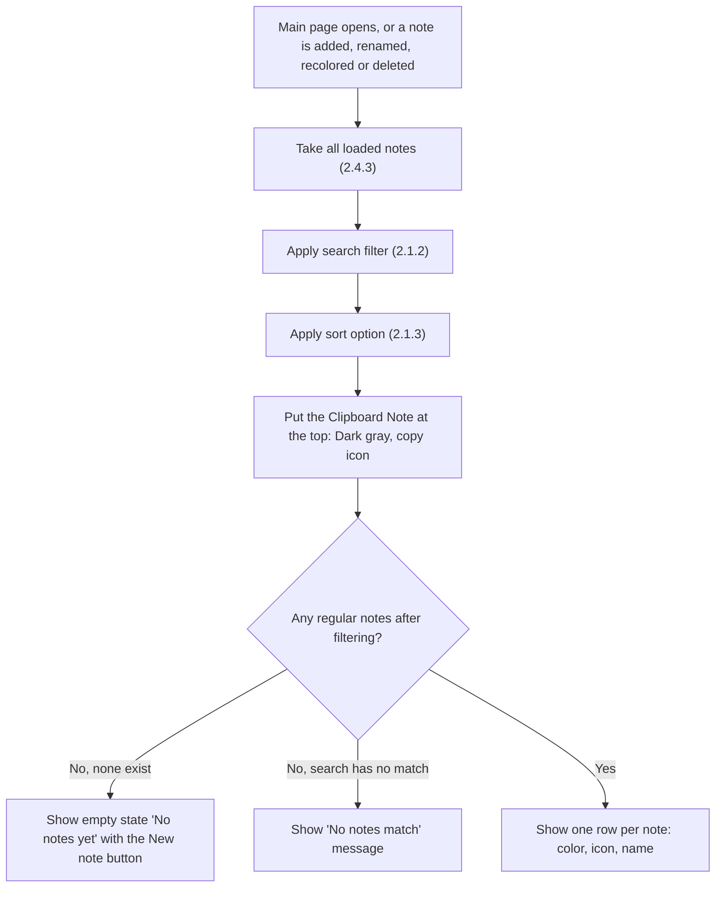
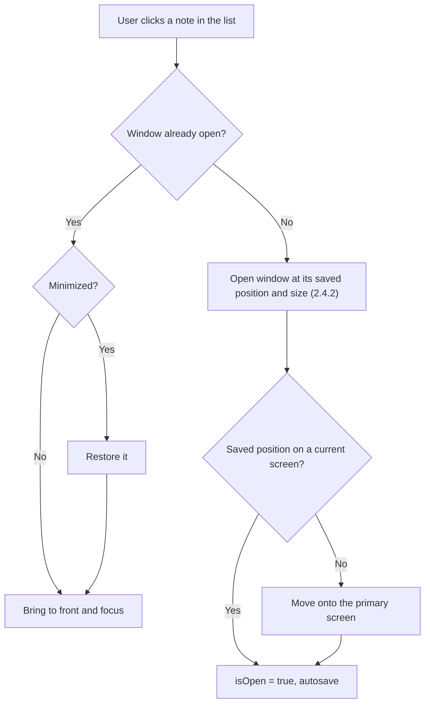

# 2.1.1 View Note List

**PRD:** 2.1.1 · **Depends on:** 2.4.3 · **Plan:** 2.5 → 3.5

The main page lists all notes (name, color, icon), with the Clipboard Note at the top. Clicking a note opens its window, or brings it to the front if it's already open.

## Flowchart — show the list

## Flowchart — click a note

## Edge cases

| # | Case | Handling |
|---|------|----------|
| 1 | No regular notes | Empty state with a New note button; the Clipboard Note row is still shown |
| 2 | Clicking a note that is already open | Brought to the front, no second window |
| 3 | Clicking a minimized note | Restored and focused |
| 4 | Saved window position is off-screen (monitor removed) | Moved onto the primary screen |
| 5 | Note name, color or icon changes in its window | The list row updates live |
| 6 | Very long names | Already limited to 30 characters (2.2.2); shown in full |
| 7 | Many notes | List scrolls |
| 8 | A note file was damaged at start | It isn't in the list (2.4.3) |

## Data touched
Reads `name`, `color`, `icon`, `isOpen`, window fields; writes `isOpen`.
