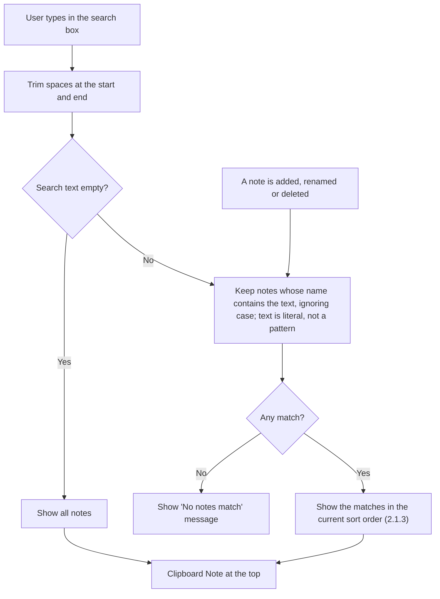

# 2.1.2 Search Notes

**PRD:** 2.1.2 · **Depends on:** 2.1.1 · **Plan:** 2.15 → 3.15

Filters the main page list by note name while the user types (case-insensitive).

## Flowchart

## Edge cases

| # | Case | Handling |
|---|------|----------|
| 1 | Search text is only spaces | Same as empty: show all |
| 2 | Upper/lower case differs ("SHOP" vs "shopping") | Matches |
| 3 | Special characters (`*`, `.`, `(`) | Searched as normal characters |
| 4 | Text matches only the note content | Not shown: names only |
| 5 | No match | "No notes match" message |
| 6 | A note is renamed while searching | The list updates live |
| 7 | Clipboard Note | Filtered like the other notes (shown only if "Clipboard" matches); always first when shown |
| 8 | Search box cleared | All notes again |

## Data touched
Reads `name`. Search text isn't saved.
