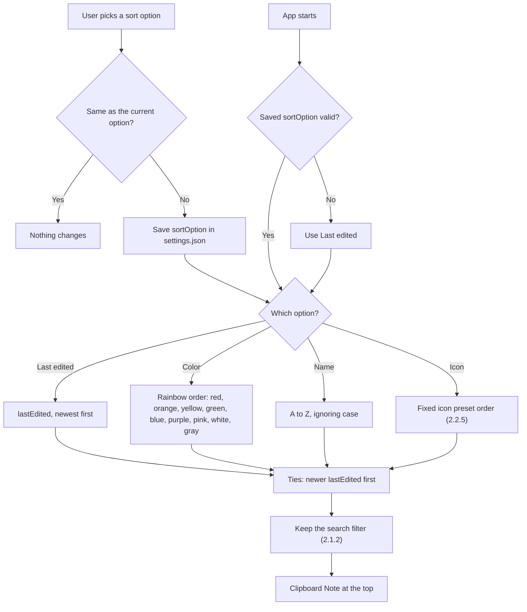

# 2.1.3 Sort Notes

**PRD:** 2.1.3 · **Depends on:** 2.1.1, 2.2.5 · **Plan:** 2.16 → 3.16

Sorts the main page list by Last edited (default), Color, Name or Icon. The choice is remembered.

## Flowchart

## Edge cases

| # | Case | Handling |
|---|------|----------|
| 1 | Notes with the same color, icon or name | Newer `lastEdited` first |
| 2 | Note edited while sorted by Last edited | Moves to the top live |
| 3 | Names starting with numbers or symbols | Normal text sort, ignoring case |
| 4 | Saved option is unknown or missing | Last edited |
| 5 | Search active | Sort applies to the filtered list |
| 6 | Clipboard Note | Always at the top, whatever the option |
| 7 | Icon sort | Preset order, not the recently-used order |

## Data touched
Settings: `sortOption`. Reads note `lastEdited`, `color`, `name`, `icon`.
