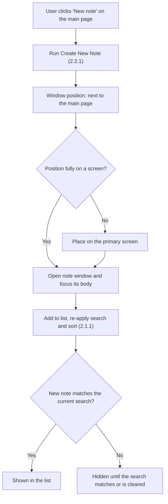

# 2.1.4 Create Note from Main Page

**PRD:** 2.1.4 · **Depends on:** 2.1.1, 2.2.1 · **Plan:** 2.6 → 3.6

The "New note" button on the main page creates a note the same way as `Ctrl+N` (2.2.1).

## Flowchart

## Edge cases

| # | Case | Handling |
|---|------|----------|
| 1 | Button double-clicked quickly | One note per click; empty notes are deleted when closed (2.2.2) |
| 2 | Main page is at the screen edge | New window is moved fully onto a screen |
| 3 | Search is active | The note opens; the list follows the search filter |
| 4 | Save fails | Same as 2.2.1: the note opens and autosave retries |

## Data touched
Same as 2.2.1.
