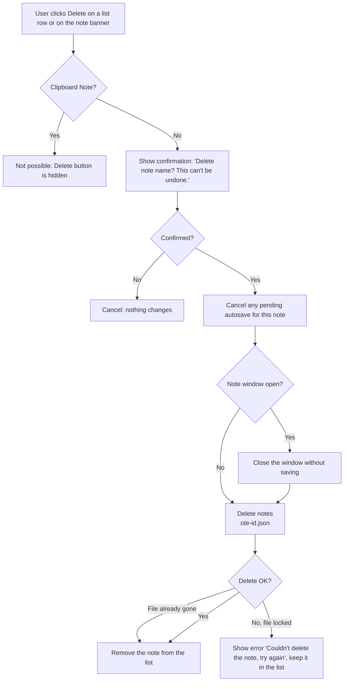

# 2.1.5 Delete Note

**PRD:** 2.1.5 · **Depends on:** 2.1.1 · **Plan:** 2.7 → 3.7

Deletes a note, after confirmation, from the list or from the note window. The Clipboard Note can't be deleted.

## Flowchart

## Edge cases

| # | Case | Handling |
|---|------|----------|
| 1 | User cancels the confirmation | Nothing changes |
| 2 | Autosave pending when deleting | Cancelled first, so the file isn't written again |
| 3 | Note window open | Closed without saving, then the file is deleted |
| 4 | File already deleted outside the app | Treated as success, the note is removed from the list |
| 5 | File locked (antivirus, sync tool) | Error shown, the note stays; the user can try again |
| 6 | Clipboard Note | No Delete button; single clipboard items are deleted in 2.3.3 |
| 7 | Empty note closed | Auto-deleted without confirmation (2.2.2), not this flow |

## Data touched
Deletes `notes\<note-id>.json`.
