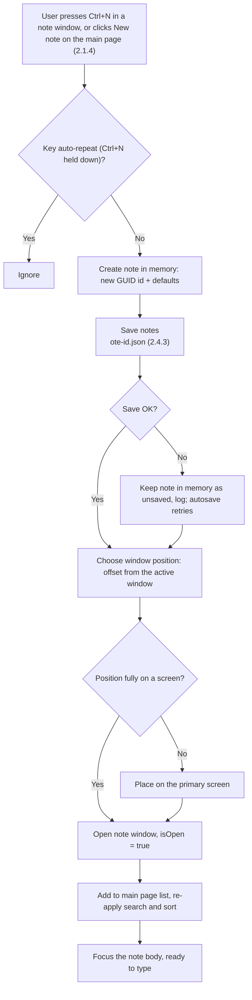

# 2.2.1 Create New Note

**PRD:** 2.2.1 · **Depends on:** 2.4.3 · **Plan:** 2.2 → 3.2

Creates a note with the default settings and opens it in a new window.

## Flowchart

## Defaults
Font Segoe UI · size Medium · color Yellow · icon `notebook` · pin off · opacity 100% · last slider opacity 80% · name "New" (automatic) · default window size (see data design).

## Edge cases

| # | Case | Handling |
|---|------|----------|
| 1 | Ctrl+N held down | Key auto-repeat is ignored: one press = one note |
| 2 | Ctrl+N pressed several times quickly | One note per press; empty ones are deleted when closed (2.2.2) |
| 3 | First save fails | Note still opens; autosave retries |
| 4 | Active window is near the screen edge | New window is moved fully onto a screen |
| 5 | Ctrl+N pressed in the Clipboard Note | Creates a regular note (the Clipboard Note is a note window) |
| 6 | Search is active and "New" doesn't match | Note opens; it shows in the list once the search matches or is cleared |
| 7 | New note left empty and closed | Deleted automatically (2.2.2) |

## Data touched
`notes\<note-id>.json`: all fields, created with defaults.
