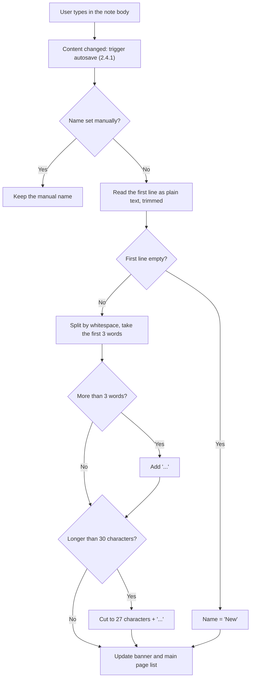
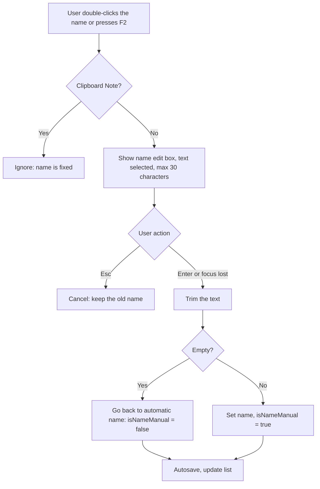
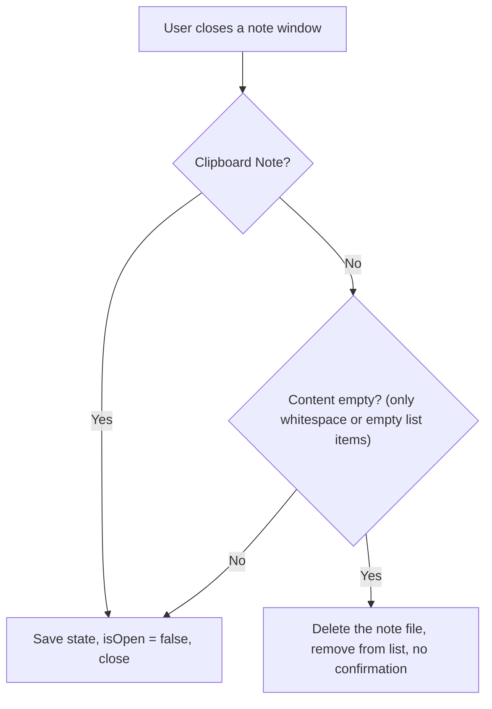

# 2.2.2 Edit Note Content & Name

**PRD:** 2.2.2 · **Depends on:** 2.2.1 · **Plan:** 2.3 → 3.3

Typing updates the content and, unless the note was renamed by hand, the automatic name. The user can rename the note manually. Empty notes are deleted when closed.

## Flowchart — typing and automatic name

## Flowchart — manual rename

## Flowchart — closing an empty note

## Edge cases

| # | Case | Handling |
|---|------|----------|
| 1 | First line is only spaces, or an empty checkbox/bullet | Treated as empty → "New" |
| 2 | First line has exactly 3 words | No "..." |
| 3 | One very long word (e.g. a URL) | Cut to 27 characters + "..." |
| 4 | Words separated by several spaces or tabs | Any whitespace splits words |
| 5 | More than 30 characters pasted into the rename box | Cut to 30 |
| 6 | Rename box emptied and confirmed | Name goes back to automatic (from the first line) |
| 7 | Rename box loses focus (click elsewhere) | Same as Enter: save |
| 8 | Note renamed manually, then content cleared and closed | Still deleted: content is empty |
| 9 | Note has only formatting (e.g. bold on) but no text | Empty → deleted on close |
| 10 | Clipboard Note | Name fixed as "Clipboard", never auto-deleted |

## Data touched
`content`, `name`, `isNameManual`, `lastEdited`, `isOpen` in `notes\<note-id>.json`.
