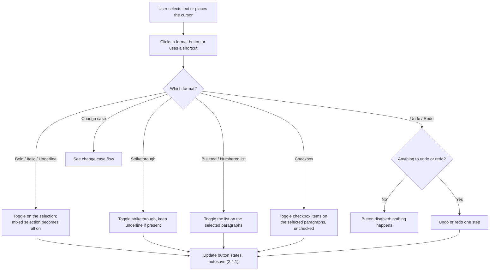
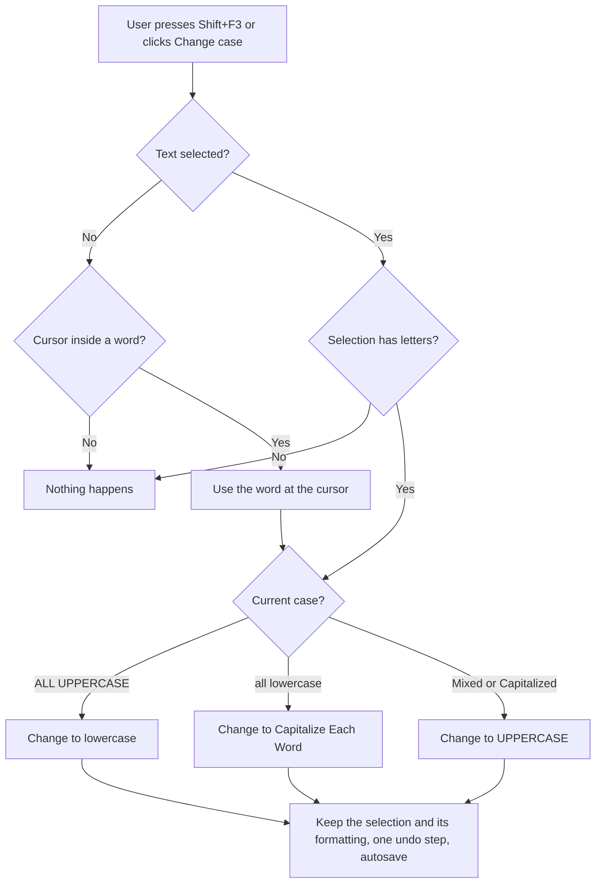
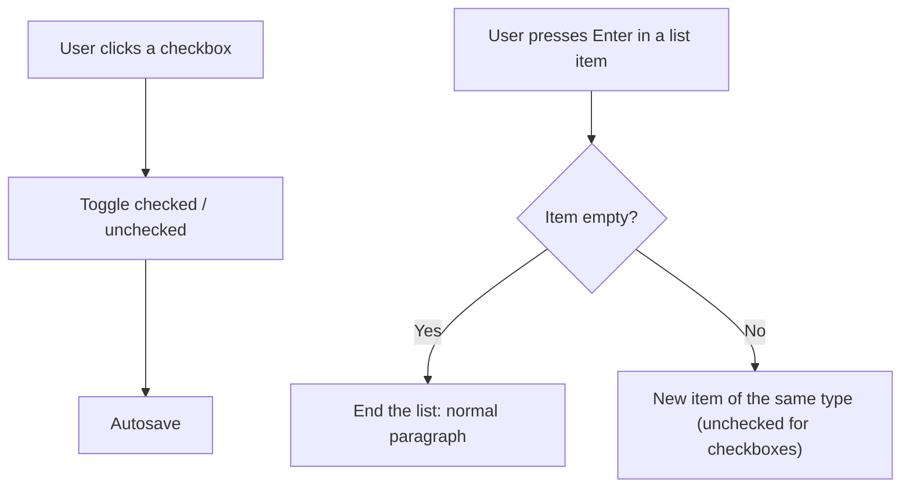

# 2.2.3 Text Formatting

**PRD:** 2.2.3 · **Depends on:** 2.2.2 · **Plan:** 2.8 → 3.8

Formatting buttons in the expanded banner (and shortcuts, 2.5): bold, italic, underline, strikethrough, bulleted list, numbered list, checkbox list, undo/redo, change case.

## Flowchart — apply a format

## Flowchart — change case (Shift+F3)

## Flowchart — checkbox items

## Edge cases

| # | Case | Handling |
|---|------|----------|
| 1 | Bold on a selection that is partly bold | All of it becomes bold; clicking again removes it |
| 2 | No selection, then Bold | Text typed next is bold |
| 3 | Change case with nothing selected and the cursor between spaces | Nothing happens |
| 4 | Change case on numbers or symbols only | Nothing happens |
| 5 | Change case on mixed text, e.g. "hELLo" | → UPPERCASE first, then the normal cycle |
| 6 | Change case across several paragraphs | Works on the whole selection |
| 7 | Rich text pasted from another app | Keeps text and supported formats (bold, italic, underline, strikethrough, lists); removes colors, fonts, sizes, images, so the note stays white on black in its own font |
| 8 | Enter on an empty list item | Ends the list |
| 9 | Backspace at the start of a list item | Removes the bullet/checkbox from that item |
| 10 | Undo after many edits | WPF's built-in undo history; Undo/Redo buttons disabled when empty |
| 11 | Clipboard Note | No formatting controls |

## Data touched
`content` (FlowDocument XAML), `lastEdited`.
