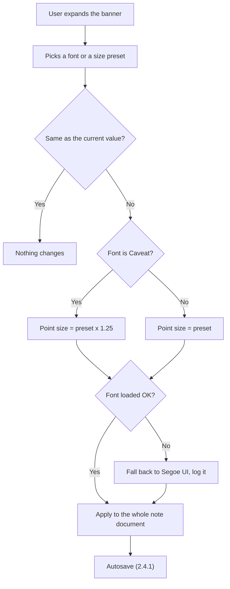

# 2.2.4 Font & Font Size

**PRD:** 2.2.4 · **Depends on:** 2.2.2 · **Plan:** 2.9 → 3.9

Each note has one font (Segoe UI, JetBrains Mono, Caveat) and one size preset (Small, Medium, Large) for the whole note.

## Flowchart

## Size presets (draft, to confirm at implementation)

| Preset | Segoe UI / JetBrains Mono | Caveat (x 1.25) |
|--------|---------------------------|-----------------|
| Small | 12 pt | 15 pt |
| Medium (default) | 14 pt | 17.5 pt |
| Large | 18 pt | 22.5 pt |

## Edge cases

| # | Case | Handling |
|---|------|----------|
| 1 | Same font or size picked again | No change, no save |
| 2 | Bundled font fails to load | Segoe UI is used, logged; the saved choice stays the same |
| 3 | Pasted text has its own font or size | Removed on paste (2.2.3), so the whole note uses one font |
| 4 | Unknown font or size in the file | Default (Segoe UI / Medium) |
| 5 | Switching to Caveat and back | Sizes follow the table above each time |
| 6 | Clipboard Note | No font controls |

## Data touched
`font`, `fontSize`, `lastEdited`.
