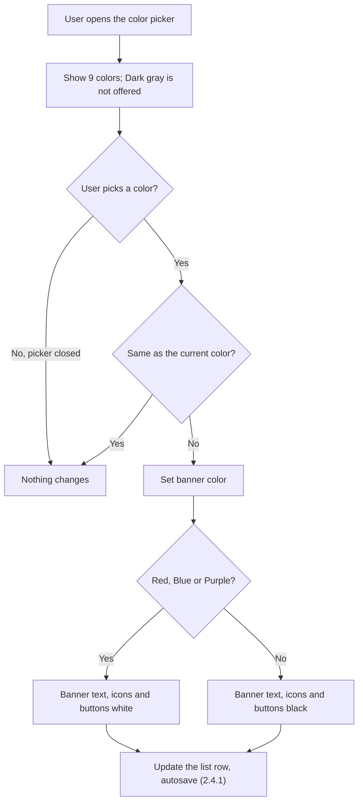
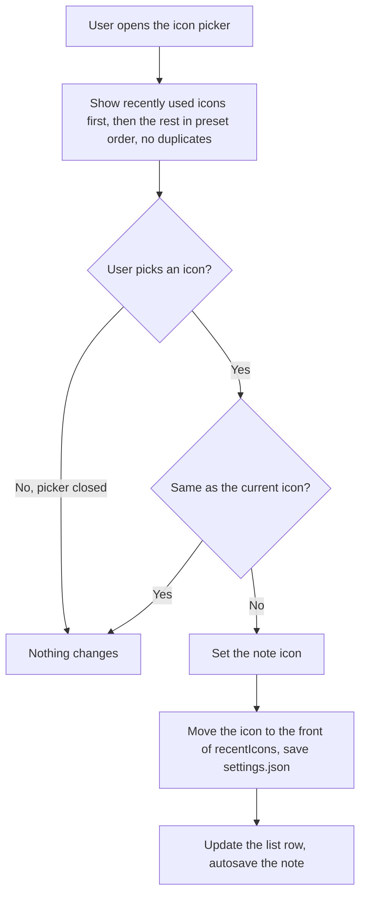

# 2.2.5 Color & Icon

**PRD:** 2.2.5 · **Depends on:** 2.2.1 · **Plan:** 2.10 → 3.10

The user picks the banner color (9 colors) and the icon (21 Lucide icons). The icon picker shows recently used icons first.

## Flowchart — color

## Flowchart — icon

## Edge cases

| # | Case | Handling |
|---|------|----------|
| 1 | Picker closed without a choice | Nothing changes |
| 2 | Same color or icon picked again | No change, no save; for icons, the recent list still isn't changed |
| 3 | File has Dark gray or an unknown color on a regular note | Yellow (2.4.3) |
| 4 | File has an unknown icon | `notebook` |
| 5 | `recentIcons` contains unknown or duplicate names | Removed when loading |
| 6 | Sort by Icon | Uses the fixed preset order, not the recent order (2.1.3) |
| 7 | Clipboard Note | Color and icon fixed, no pickers |

## Data touched
Note: `color`, `icon`, `lastEdited`. Settings: `recentIcons`.
