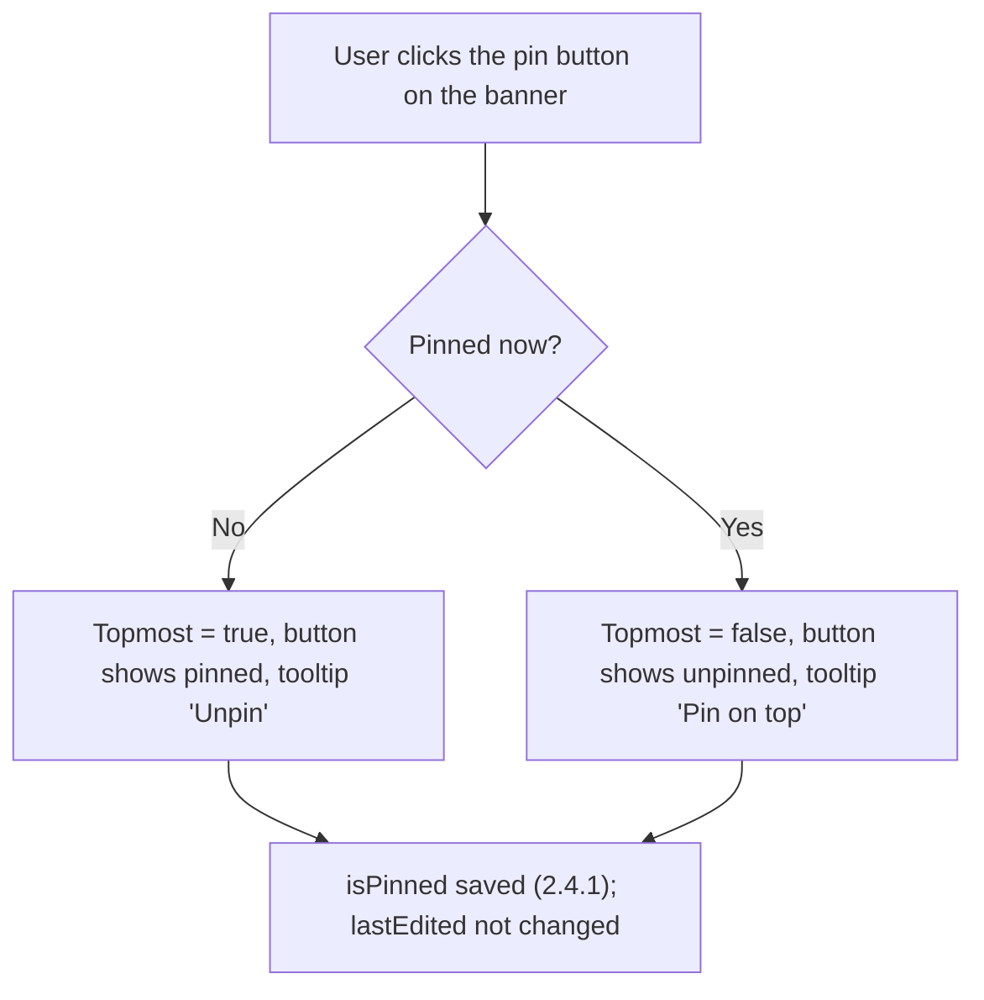

# 2.2.6 Pin on Top

**PRD:** 2.2.6 · **Depends on:** 2.2.1 · **Plan:** 2.11 → 3.11

The pin button keeps the note window above all other windows.

## Flowchart

## Edge cases

| # | Case | Handling |
|---|------|----------|
| 1 | Several pinned notes | All stay above other windows; the last one clicked is in front |
| 2 | Clicking the main page or another app | Pinned notes stay on top |
| 3 | Pinned note minimized and restored | Still pinned |
| 4 | App restarted | Pinned state restored (2.4.2) |
| 5 | Clipboard Note | Pin button available, same behavior |

## Data touched
`isPinned`.
