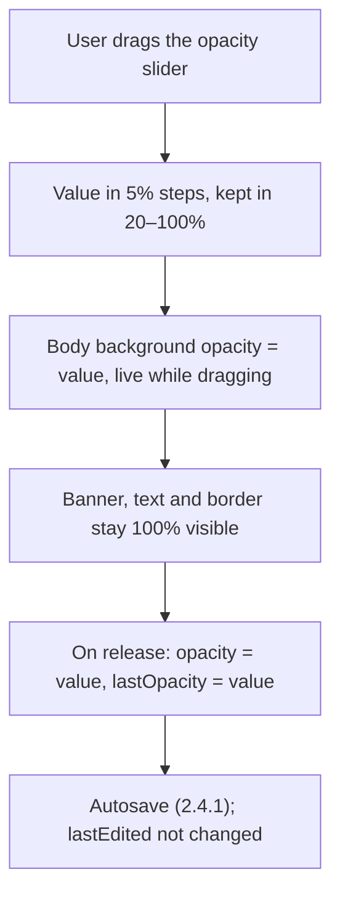
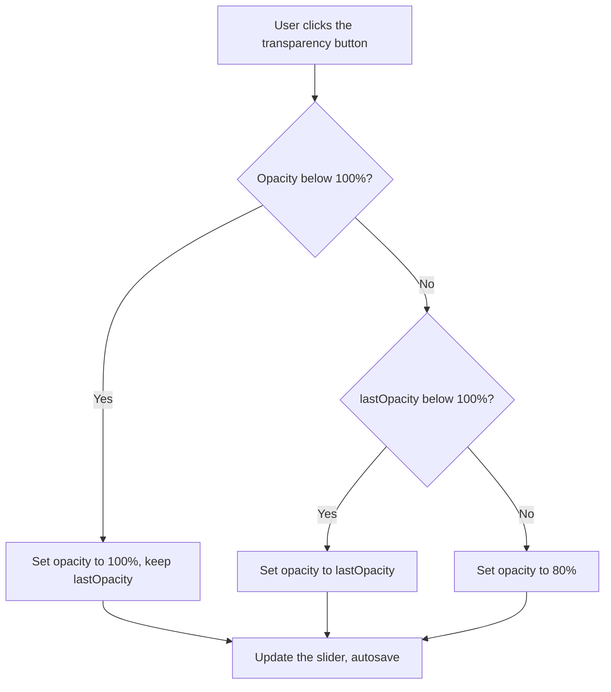

# 2.2.7 Transparent Body

**PRD:** 2.2.7 · **Depends on:** 2.2.1 · **Plan:** 2.12 → 3.12

The opacity slider (20–100%) changes only the body background. The transparency button switches between 100% and the last slider value.

## Flowchart — slider

## Flowchart — transparency button

## Edge cases

| # | Case | Handling |
|---|------|----------|
| 1 | Slider never used | Button switches between 100% and 80% |
| 2 | Slider set to 100% | Button falls back to 80%, so it still does something |
| 3 | Value below 20% or above 100% in the file | Clamped to 20–100% (2.4.3) |
| 4 | Dragging the slider quickly | Live preview; saved once on release |
| 5 | Any opacity | Banner, text and border always fully visible |
| 6 | Clipboard Note | Same slider and button |

## Data touched
`opacity`, `lastOpacity`.
