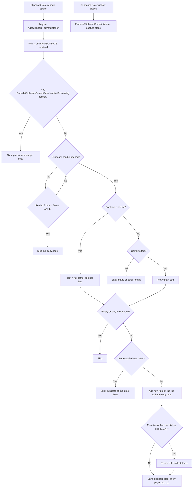

# 2.3.1 Capture Copied Text

**PRD:** 2.3.1 · **Depends on:** 2.2.1, 2.4.3 · **Plan:** 2.18 → 3.18

While the Clipboard Note window is open, text and file paths copied in any app are added as new items at the top.

## Flowchart

## Edge cases

| # | Case | Handling |
|---|------|----------|
| 1 | Clipboard Note closed | Nothing is captured |
| 2 | Password copied from a password manager | Skipped (`ExcludeClipboardContentFromMonitorProcessing`) |
| 3 | Image copied | Skipped |
| 4 | Image + text copied together (browser, Excel) | Text is captured |
| 5 | One file copied in File Explorer | Its full path, e.g. `D:\code\notes\PRD.md` |
| 6 | Several files copied | One item, one path per line |
| 7 | Same text copied twice in a row | Second copy skipped (only compared with the latest item) |
| 8 | Same text as an older item (not the latest) | Captured as a new item |
| 9 | Clipboard locked by another app | Retry 3 times, then skip and log |
| 10 | Whitespace-only text | Skipped |
| 11 | Windows sends two update events for one copy | The duplicate check skips the second |
| 12 | Very large text (e.g. several MB) | Stored up to 100,000 characters; the rest is cut |
| 13 | Rich text (HTML/RTF) copied | Plain text only |
| 14 | Copy made with the item Copy button (2.3.3) | Captured again as a new top item, as intended |

## Data touched
`clipboard.json`: `items` (id, text, copiedAt).
