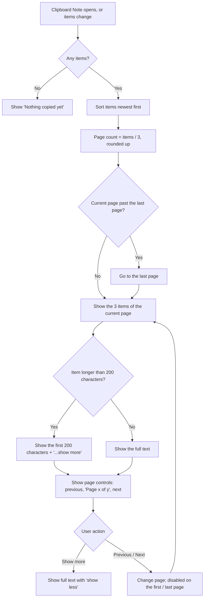

# 2.3.2 View Clipboard History in Pages

**PRD:** 2.3.2 · **Depends on:** 2.3.1 · **Plan:** 2.19 → 3.19

Shows clipboard items newest first, 3 per page. Items over 200 characters are cut off with "...show more".

## Flowchart

## Edge cases

| # | Case | Handling |
|---|------|----------|
| 1 | No items | "Nothing copied yet", no page controls |
| 2 | 1–3 items | One page; previous and next disabled |
| 3 | Last item on the last page deleted | Go to the previous page |
| 4 | New item captured | Show page 1, unless an item is being edited (2.3.3) |
| 5 | Exactly 200 characters | Shown in full, no "show more" |
| 6 | Text with many lines | Same 200-character rule (newlines count as characters) |
| 7 | Cut falls inside an emoji or surrogate pair | Cut before it, so no broken character |
| 8 | Banner | Dark gray `#1A1A1A`, Lucide `copy` icon, name "Clipboard" |

## Data touched
Reads `clipboard.json` `items`. The current page isn't saved.
