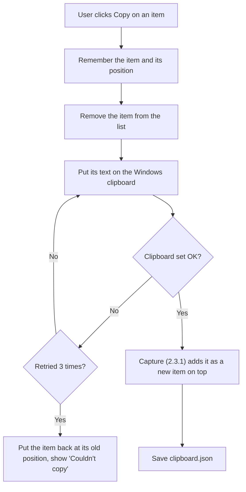
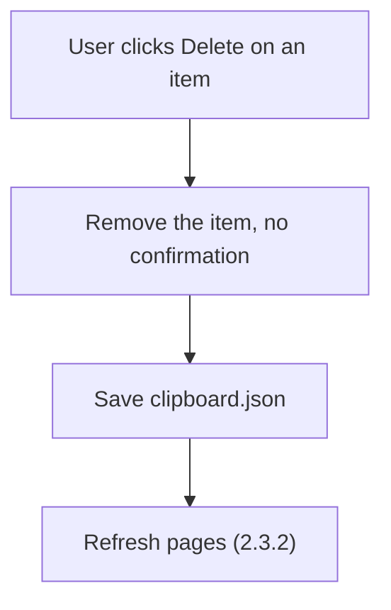
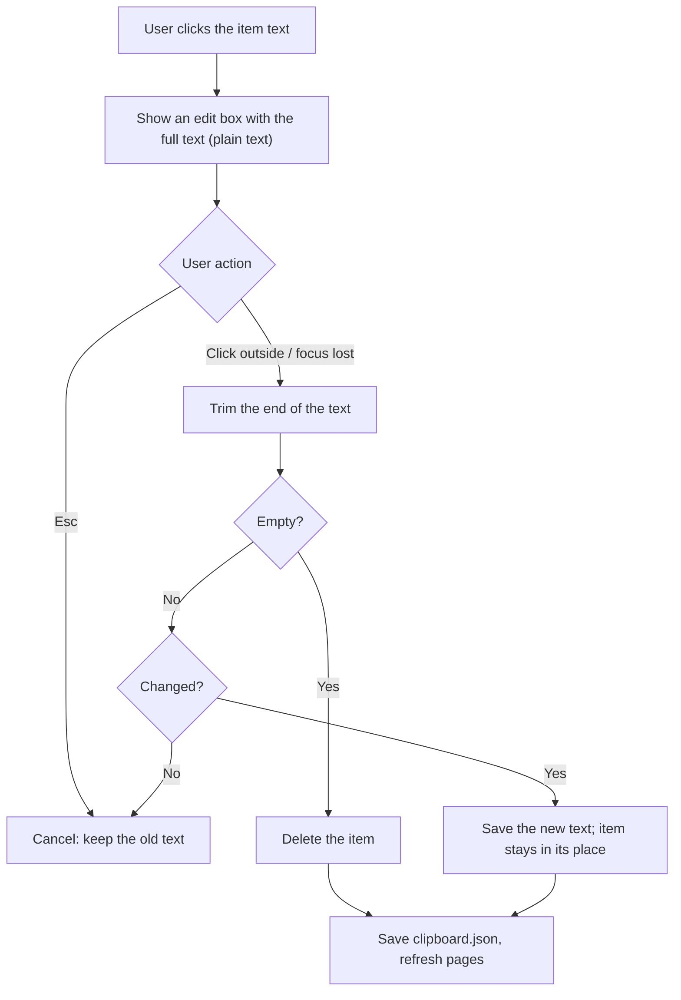

# 2.3.3 Clipboard Item Actions

**PRD:** 2.3.3 · **Depends on:** 2.3.2 · **Plan:** 2.20 → 3.20

Each clipboard item has a Copy button, a Delete button, and can be edited by clicking its text.

## Flowchart — Copy

## Flowchart — Delete

## Flowchart — Edit

## Edge cases

| # | Case | Handling |
|---|------|----------|
| 1 | Copy on the latest item | Removed, then captured again on top (same final order) |
| 2 | Copy on an older item | Moves to the top |
| 3 | Clipboard locked during Copy | Retry 3 times, then put the item back and show a message |
| 4 | Delete the last item of a page | Pages refresh (2.3.2) |
| 5 | Edited text becomes empty | Item is deleted |
| 6 | Edit with no change | Nothing is saved |
| 7 | Enter in the edit box | New line (items can have several lines) |
| 8 | New copy captured while editing | Added on top; the view doesn't jump until editing ends |
| 9 | Editing a cut-off item | The edit box shows the full text |
| 10 | Edited text is the same as the latest item | Allowed (the duplicate rule only applies to new copies) |

## Data touched
`clipboard.json`: `items`.
