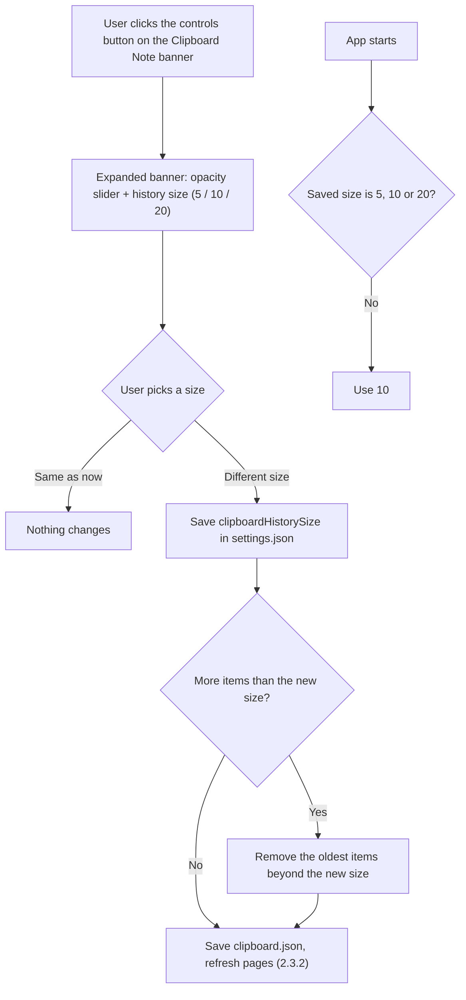

# 2.3.4 History Size Option

**PRD:** 2.3.4 · **Depends on:** 2.3.2 · **Plan:** 2.21 → 3.21

In the Clipboard Note's expanded banner, the user picks how many items to keep: 5, 10 (default) or 20.

## Flowchart

## Edge cases

| # | Case | Handling |
|---|------|----------|
| 1 | Size made smaller with more items than the new size | Oldest items removed right away, no confirmation |
| 2 | Size made bigger | Nothing removed; more room for new copies |
| 3 | History full and a new copy comes in | Oldest item removed (2.3.1) |
| 4 | Saved size is invalid (e.g. 7) | 10 |
| 5 | Same size picked again | Nothing changes |

## Data touched
Settings: `clipboardHistorySize`. Clipboard: `items`.
