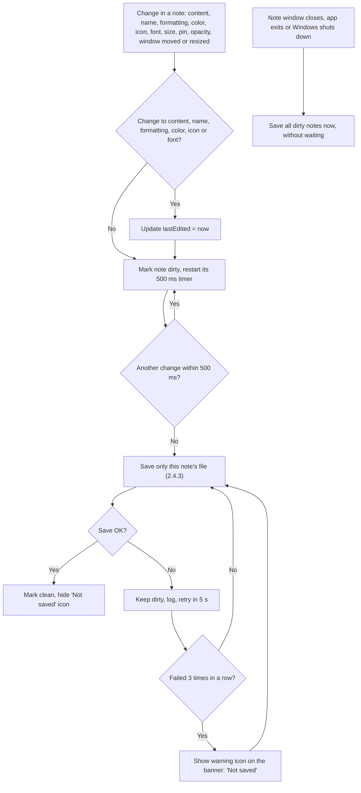

# 2.4.1 Autosave

**PRD:** 2.4.1 · **Depends on:** 2.4.3, 2.2.2 · **Plan:** 2.4 → 3.4

Every change is saved automatically, and only to the file of the note that changed. A short delay groups fast changes (typing) into one save.

## Flowchart

## Edge cases

| # | Case | Handling |
|---|------|----------|
| 1 | Fast typing | One save after 500 ms with no changes, not one per key |
| 2 | Window dragged or resized | Saved once the drag or resize ends |
| 3 | App closed while a save is pending | Pending saves are written immediately before exit |
| 4 | Windows shutdown or sign-out | Same as app exit: save all dirty notes |
| 5 | Save keeps failing (disk full, file locked) | Data stays in memory; retry every 5 s; warning icon after 3 failures; icon goes away after a successful save |
| 6 | Note deleted while a save is pending | Pending save is cancelled, so the file isn't created again (see 2.1.5) |
| 7 | Change with no real effect (same color picked again) | No save |
| 8 | Pin, opacity or window changes | Saved, but `lastEdited` is not changed, so "Last edited" sort isn't affected |

## Data touched
Any field of the changed `notes\<note-id>.json` or `clipboard.json`.
