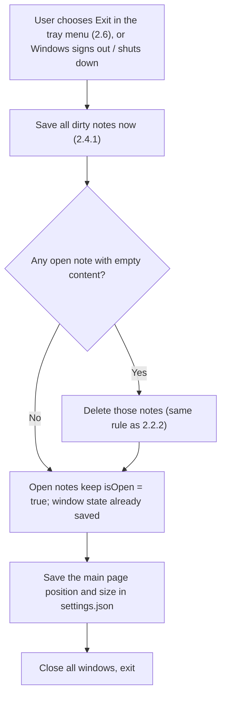
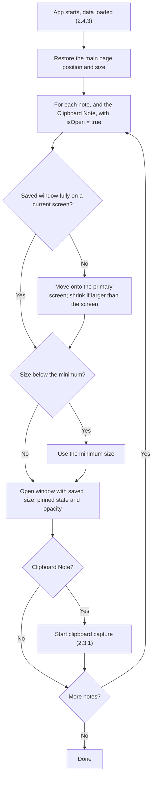

# 2.4.2 Remember Window State

**PRD:** 2.4.2 · **Depends on:** 2.4.1, 2.2.6, 2.2.7 · **Plan:** 2.14 → 3.14

When the app restarts, the notes that were open reopen at the same position and size, with the same pinned state and opacity.

## Flowchart — closing the app

## Flowchart — starting the app

## Edge cases

| # | Case | Handling |
|---|------|----------|
| 1 | Closing a single note window | `isOpen = false`; it won't reopen at the next start |
| 2 | Closing the main page | Hides it to the tray; the app keeps running (2.6). If there's no tray icon, it exits the app |
| 3 | Monitor removed or resolution changed | Off-screen windows are moved onto the primary screen and shrunk to fit |
| 4 | Saved size too small or invalid | Minimum size is used |
| 5 | Note was minimized when the app closed | Reopens normally (minimized state isn't saved) |
| 6 | Empty note open when the app closes | Deleted, as if closed (otherwise it would reopen empty) |
| 7 | App crashes | Last autosaved state is used at the next start |
| 8 | Different DPI scaling | Positions are saved in WPF device-independent units |

## Data touched
Note and Clipboard: `window` (left, top, width, height), `isPinned`, `opacity`, `isOpen`. Settings: `mainWindow`.
