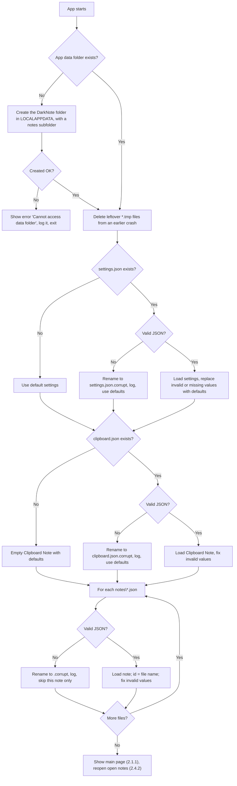
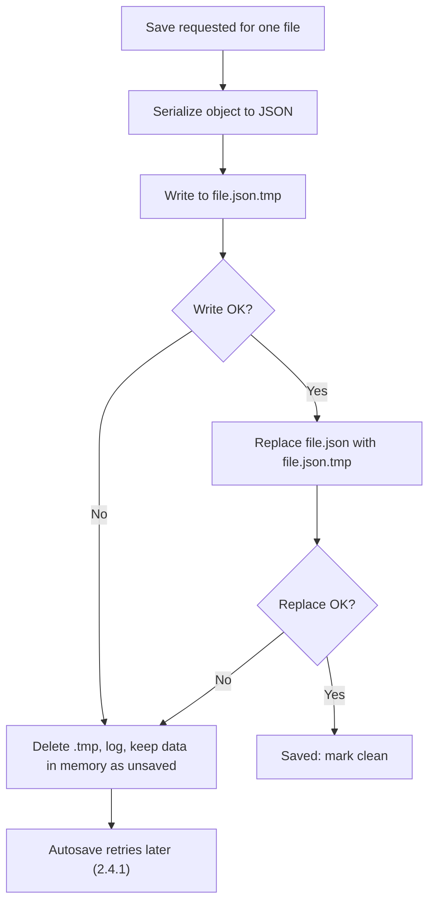

# 2.4.3 Storage Structure

**PRD:** 2.4.3 · **Depends on:** — · **Plan:** 2.1 → 3.1

Loads all data when the app starts, and saves one file safely whenever something changes. All other functions read and write data through this one. File formats are in [`docs/data-design.md`](../data-design.md).

## Flowchart — load on start

## Flowchart — save one file

## Edge cases

| # | Case | Handling |
|---|------|----------|
| 1 | First run, no data folder | Create the folder and `notes\`, start with defaults |
| 2 | Data folder can't be created or read (permissions) | Show an error and exit, so data is never lost silently |
| 3 | `settings.json` or `clipboard.json` is damaged | Rename it to `*.corrupt` (kept for recovery), log it, use defaults |
| 4 | A note file is damaged | Rename it to `*.corrupt`, log it, skip only that note; all other notes load |
| 5 | Leftover `*.tmp` files (app crashed mid-save) | Delete them; the original file is still the last good version |
| 6 | Missing or unknown fields (older/newer file) | Missing → default; unknown → ignored |
| 7 | Invalid values (opacity 5, unknown color, name > 30 characters, Dark gray on a regular note) | Replace with the nearest valid value or the default (see data design) |
| 8 | `id` inside the file differs from the file name | Use the file name as the id |
| 9 | Write fails (disk full, file locked by antivirus) | Old file stays untouched; data stays in memory; autosave retries |
| 10 | Two notes save at the same time | No conflict: each note has its own file |

## Data touched
`settings.json`, `clipboard.json`, `notes\<note-id>.json` (all fields).
