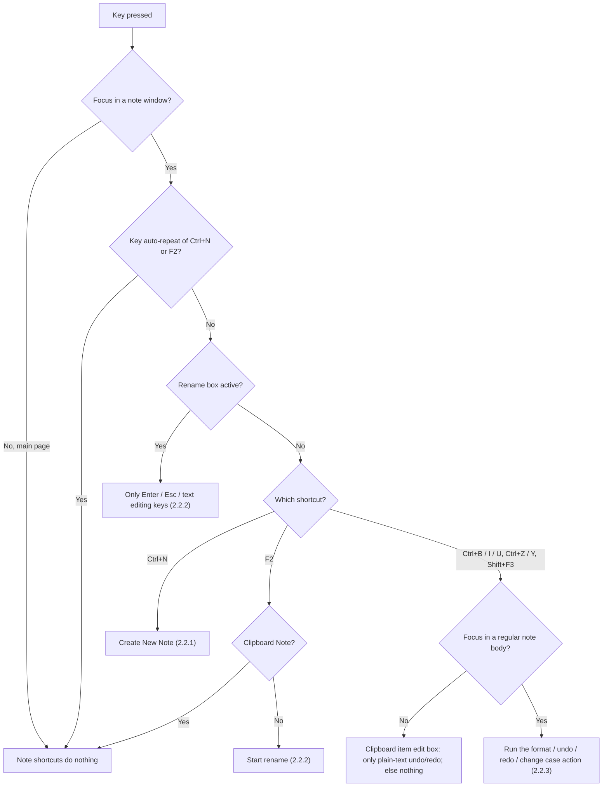
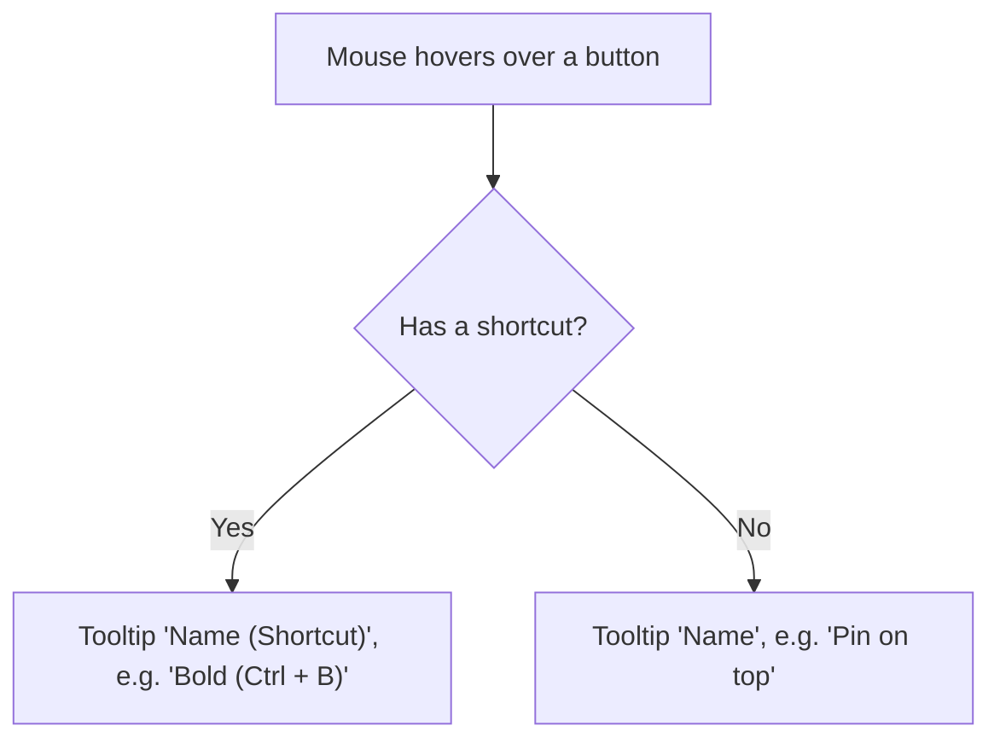

# 2.5 Keyboard Shortcuts

**PRD:** 2.5 · **Depends on:** 2.2.1, 2.2.3 · **Plan:** 2.13 → 3.13

Routes key presses to the right action, and shows a tooltip with the name and shortcut on every button.

## Flowchart — key press

## Flowchart — tooltip

## Shortcut list

| Shortcut | Where | Action |
|----------|-------|--------|
| `Ctrl + N` | Any note window | Create a new note |
| `F2` | Regular note window | Rename |
| `Ctrl + B / I / U` | Regular note body | Bold / Italic / Underline |
| `Ctrl + Z / Y` | Regular note body | Undo / Redo |
| `Shift + F3` | Regular note body | Change case |

## Edge cases

| # | Case | Handling |
|---|------|----------|
| 1 | `Ctrl+N` held down | One note only (auto-repeat ignored) |
| 2 | Shortcut on the main page | Does nothing |
| 3 | `Ctrl+B` while renaming | Does nothing |
| 4 | Formatting shortcuts in the Clipboard Note | Do nothing (no formatting there) |
| 5 | `F2` in the Clipboard Note | Does nothing (name is fixed) |
| 6 | `Ctrl+Y` with nothing to redo | Nothing happens |

## Data touched
None directly; actions save through their own functions.
