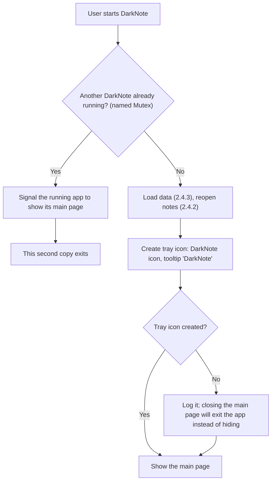
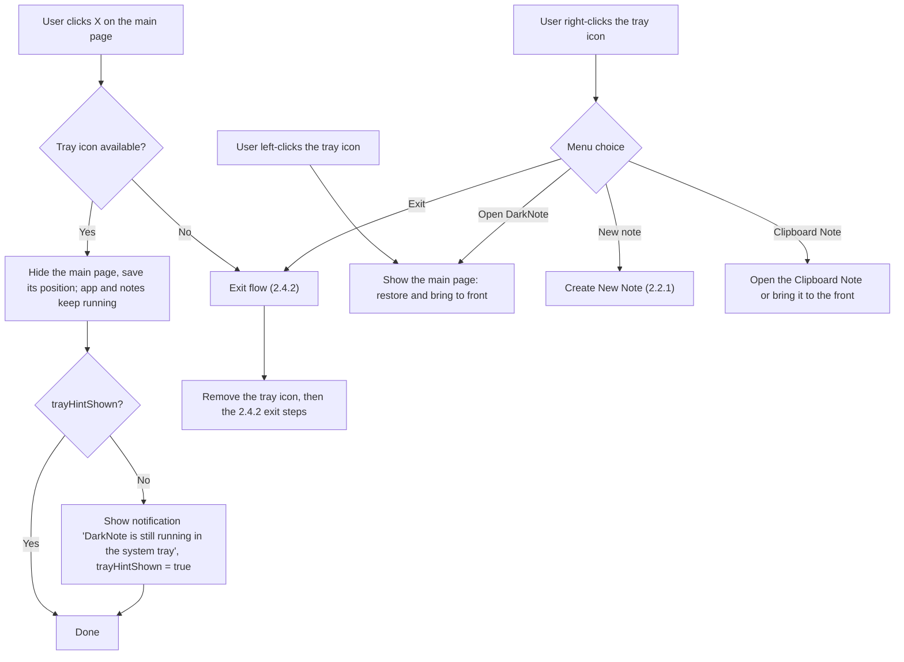

# 2.6 System Tray Icon & App Icon

**PRD:** 2.6 · **Depends on:** 2.1.1, 2.4.2 · **Plan:** 2.17 → 3.17

One shared DarkNote icon for the app and all its windows. A tray icon keeps the app running when the main page is closed. Only one copy of the app can run.

## Flowchart — app start (single instance + tray)

## Flowchart — closing the main page and the tray icon

## Edge cases

| # | Case | Handling |
|---|------|----------|
| 1 | DarkNote started while it's already running | The running copy shows its main page; the new copy exits |
| 2 | Main page hidden, user starts DarkNote from the Start menu | Same as 1: the hidden main page is shown |
| 3 | Main page closed for the first time | One-time notification; later closes are silent |
| 4 | Tray icon can't be created | Closing the main page exits the app (old behavior), so the app is never invisible |
| 5 | Windows Explorer restarts (tray is rebuilt) | Tray icon is added again |
| 6 | Tray icon hidden in the "^" overflow area | Works the same; that's a Windows setting |
| 7 | Exit while notes have pending saves | Saves are flushed first (2.4.1) |
| 8 | Windows sign-out or shutdown | Same as Exit |
| 9 | App icon file missing or broken at build time | Build fails, so it's fixed before release |
| 10 | Icon at 16 px (tray, title bar) | Uses the 16 px image in the `.ico`, not a scaled-down large image |

## Data touched
Settings: `trayHintShown`, `mainWindow`.
